# Project Ventrix
## Ventrix CRM - Frontend
React frontend for an AI Powered cient and Lead Management system, built for Ventrix Technologies Full Stack developer intern assessment 

## Live links 
Live Application link - https://ventrix-crm-frontend.vercel.app/login
Live API [backend] - https://ventrix-crm.onrender.com

## Repositories 
Frontend - https://github.com/sivasankaranit44-wq/ventrix_crm_frontend

Backend - https://github.com/sivasankaranit44-wq/ventrix_crm

The kind Note - Backend runs on Render's tier, so the fist request after inactiivity take few seconds

## Demo Login 
email - sivasankarang@gmail.com
password - Sankaran98

## Screenshots 
**Adding the screenshots for the features**
### Login
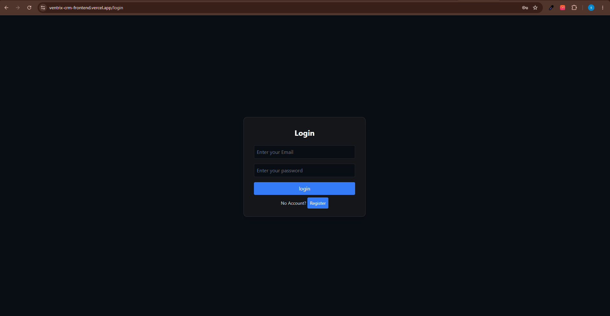
### Register
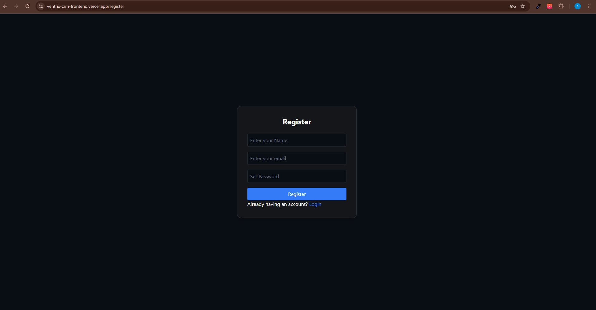
### Qualfied to convert (lead status)
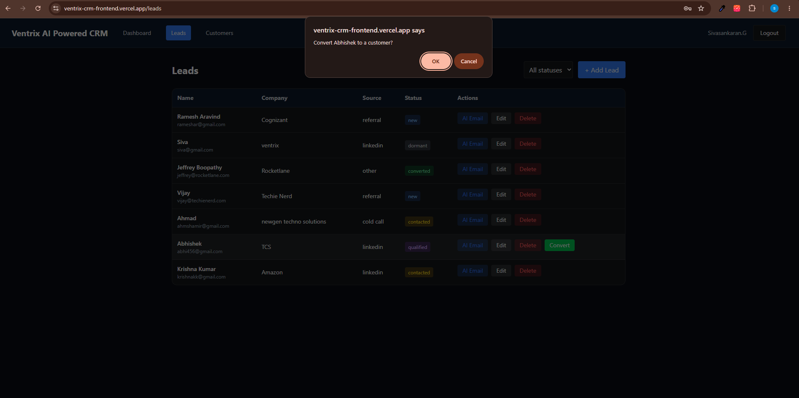
### Leads
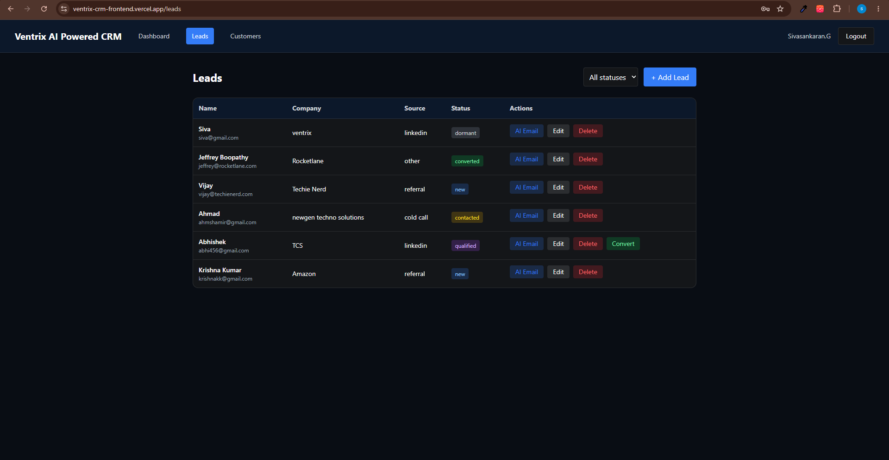
## Leads Edit
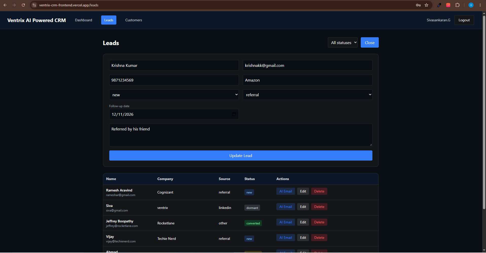
### Delete
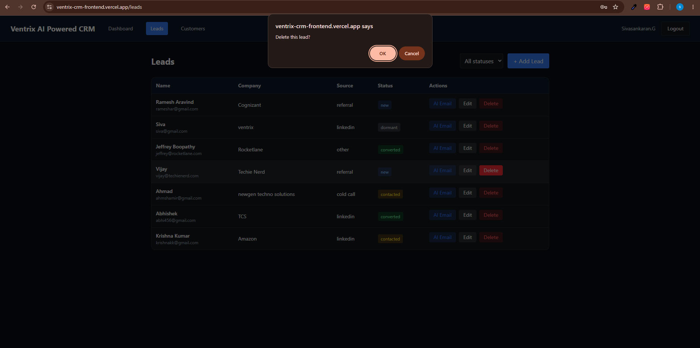
### Dashboard
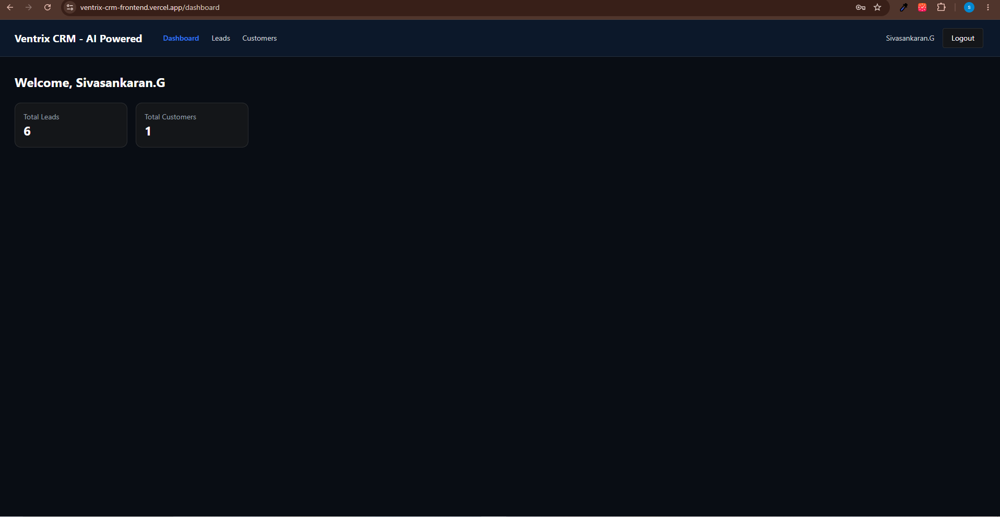
### Customers page (who is converted)
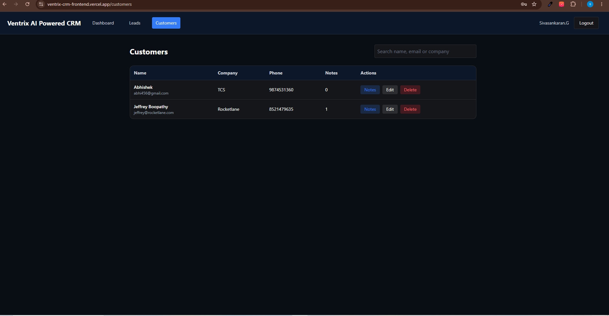
### AI mail generation loading process
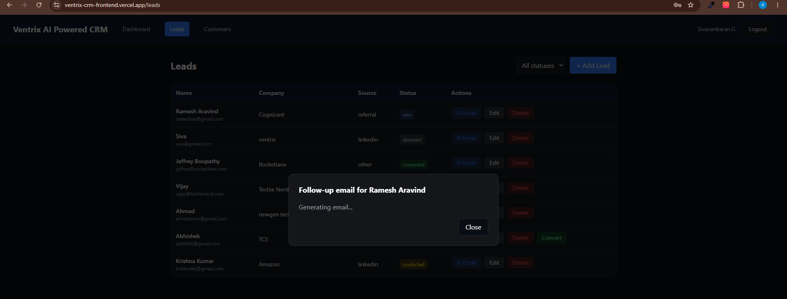
### Ai Mail generation
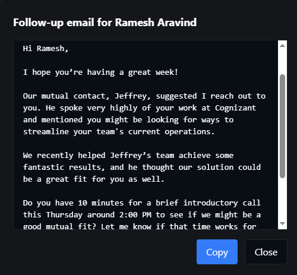
### Add lead
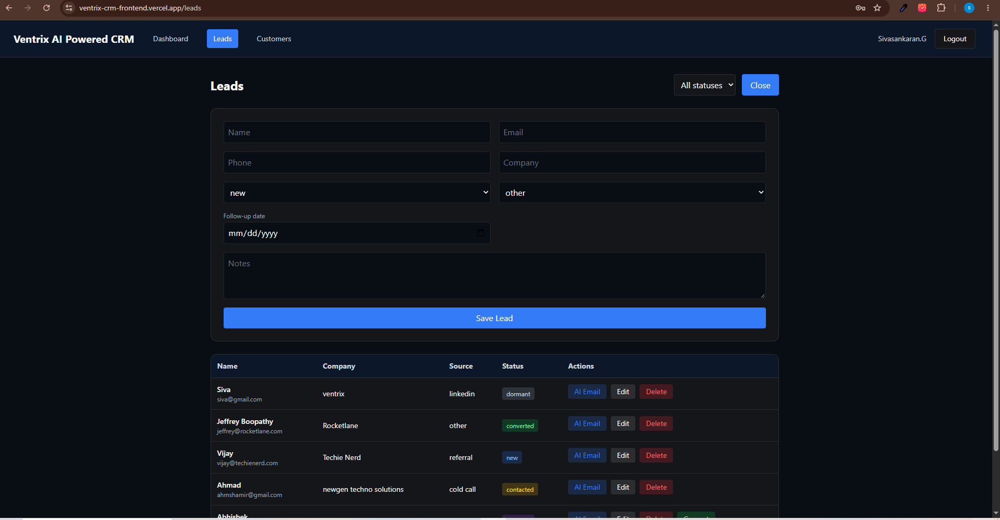
### Add lead feature
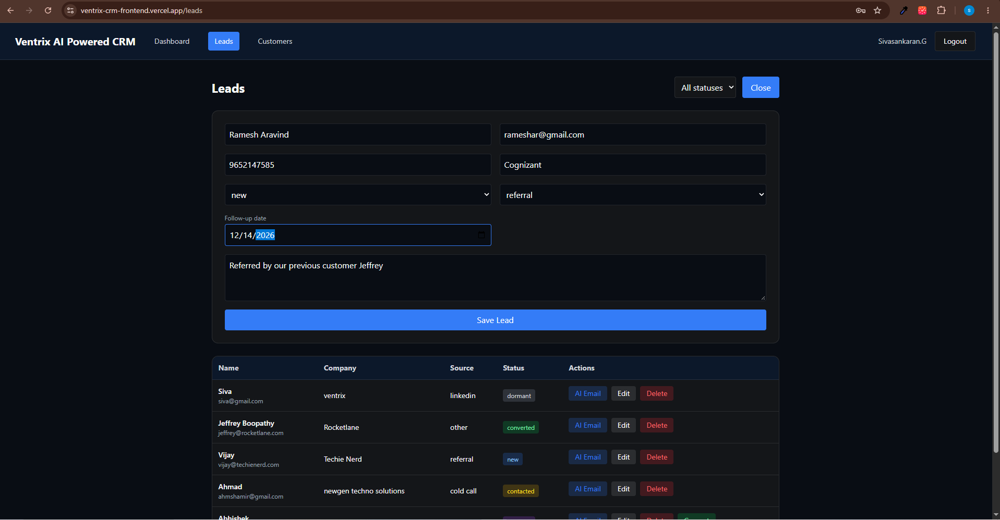

## AI-Email content for one of the Lead
## Generated by AI feature (Google Gemini)

Subject: Intro via Jeffrey / Connecting with Cognizant

Hi Ramesh,

I hope you’re having a great week! 

Our mutual contact, Jeffrey, suggested I reach out to you. He spoke very highly of your work at Cognizant and mentioned you might be looking for ways to streamline your team's current operations.

We recently helped Jeffrey’s team achieve some fantastic results, and he thought our solution could be a great fit for you as well.

Do you have 10 minutes for a brief introductory call this Thursday around 2:00 PM to see if we might be a good mutual fit? Let me know if that time works for you.

Best regards,
Sivasankaran.G

## Feautures 
Register and Login with the protected dashboard(JWT)
Leads Page - Add, list, filter, edit, delete status and Follow-up date and notes for the follow up reference 
AI Follow up email generator for each lead
Convert a lead into a customer
Customers Page - notes, edit, search and delete
Dark theme matching the ventrix website(not so accurate as real website theme)

## Tech Stack used
React.js(Vite), React Router, Axios, Tailwind CSS, Context API for auth. Deployed on Vercel

## Project Structure
src/
    api.js
    context/  --> Axios instance with API base URL and token
    components/ Navbar, ProtectedRoute
    pages/ Login, Regsiter, Dashboard, Customers, Leads
    App.jsx, main.jsx

## Setup instruction
**1 clone the repository**
git Clone https://github.com/sivasankaranit44-wq/ventrix_crm_frontend.git
cd ventrix_crm_frontend

**2 Install dependencies**
npm install

**3.create a .env file (see .env.example) from git**
VITE_API_URL=https://ventrix-crm.onrender.com
Localhost - http://localhost:5173

**4 Start the development server**
npm run dev

**5 Buid for production**
npm run build

## Deployment 
deployed on vercel set the environment variable VITE_API_URL in the vercel project settings. A vercel.json rewrite is included so that page refreshes on routes like /leads work.

## AI usage details
Claude - Code suggestions, UI Suggestions and debugging assistance

I built tested and debugged the application and can explain the implementation

## Author 
Sivasankaran